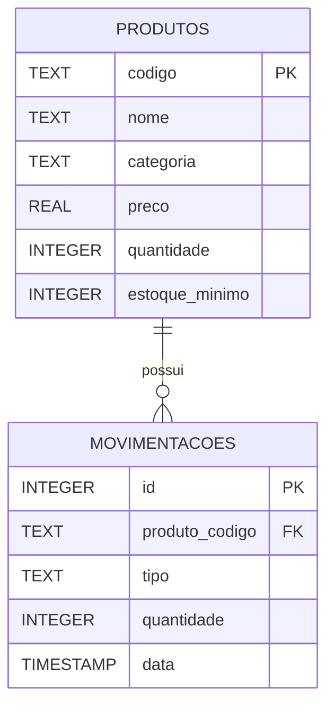

# Sistema de Controle de Estoque com GUI e SQLite

## Funcionalidades Implementadas

- **Menu Principal Integrado:** Navegação lateral entre todas as telas do sistema com indicador dinâmico de alertas de estoque baixo.
- **Cadastro e Edição de Produtos:** Inserção, busca por código e atualização de dados (código único, nome, categoria, preço unitário, quantidade inicial e estoque mínimo).
- **Registro de Movimentações:** Controle de **entradas** (compras/reposições) e **saídas** (vendas/uso), impedindo saídas maiores que o saldo disponível.
- **Consulta de Estoque:** Visualização tabular completa com **filtro por categoria**, destaque visual para itens abaixo do estoque mínimo e cálculo automático do **valor total em estoque**.
- **Relatórios e Alertas:** Painel consolidado com total de produtos, lista prioritária de itens em alerta de estoque baixo, histórico completo de movimentações e **exportação para CSV**.

---

## Estrutura do Projeto

```text
controle_estoque/
├── banco.sql                  # Script DDL de criação das tabelas e trigger
├── main.py                    # Ponto de entrada da aplicação
├── README.md                  # Documentação do projeto
├── banco/
│   ├── __init__.py
│   ├── conexao.py             # Gerenciamento de conexão e inicialização do SQLite
│   ├── produtos.py            # Operações CRUD e consultas de produtos
│   └── movimentacoes.py       # Registro e histórico de entradas e saídas
├── interface/
│   ├── __init__.py
│   ├── menu_principal.py      # Janela principal e navegação entre frames
│   ├── cadastro_produtos.py   # Tela de cadastro e atualização de produtos
│   ├── registro_movimentacao.py # Tela de lançamento de entradas/saídas
│   ├── consulta_estoque.py    # Tela de consulta, filtros e exportação
│   └── relatorios.py          # Tela de indicadores, alertas e histórico
└── utilitarios/
    ├── __init__.py
    ├── validacoes.py          # Validações de código, preço e quantidades
    └── exportacao.py          # Geração de relatórios em formato CSV
```

---

## Diagrama do Banco de Dados

O banco SQLite (`estoque.db`) é criado a partir do `banco.sql` e relaciona `produtos` e `movimentacoes` por meio da chave estrangeira `produto_codigo`.



---

## Como Executar

1. Certifique-se de ter o **Python 3.10+** instalado.
2. Na pasta do projeto, execute:
   ```bash
   python main.py
   ```
